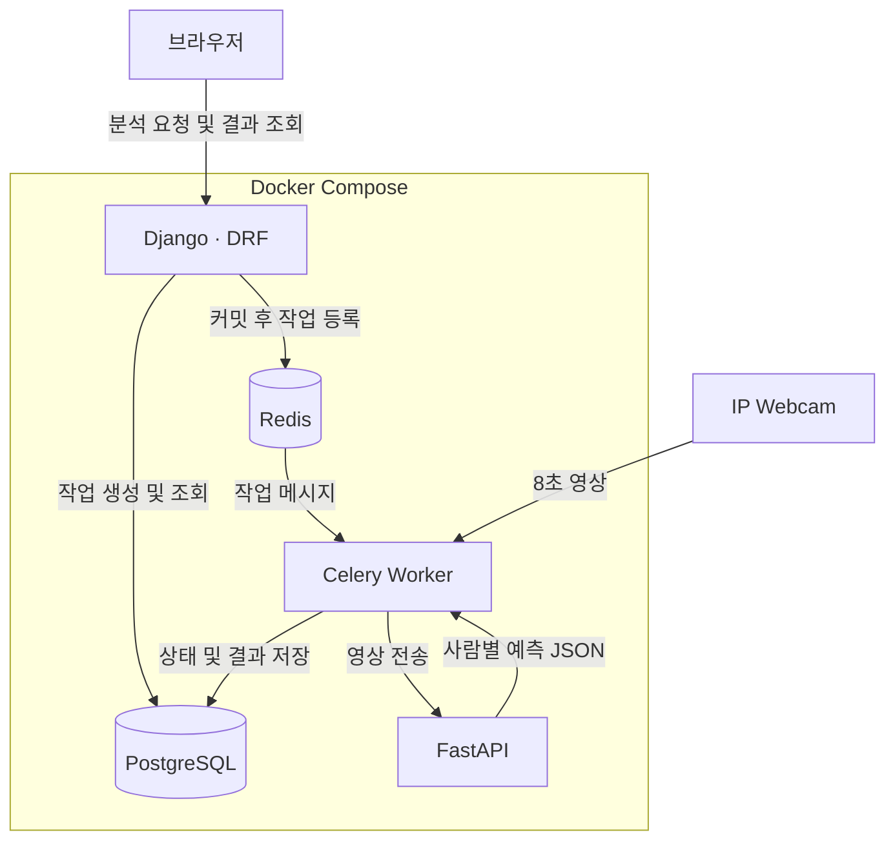
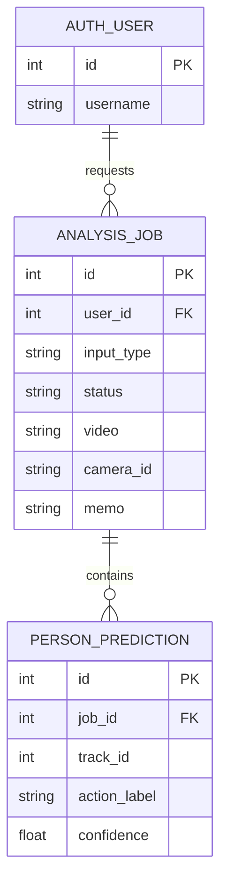
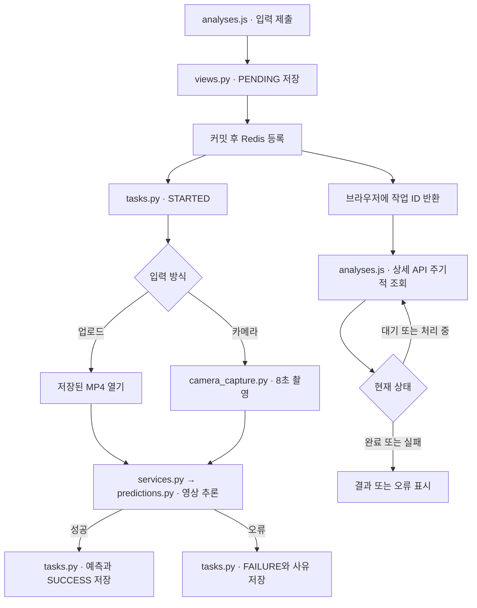
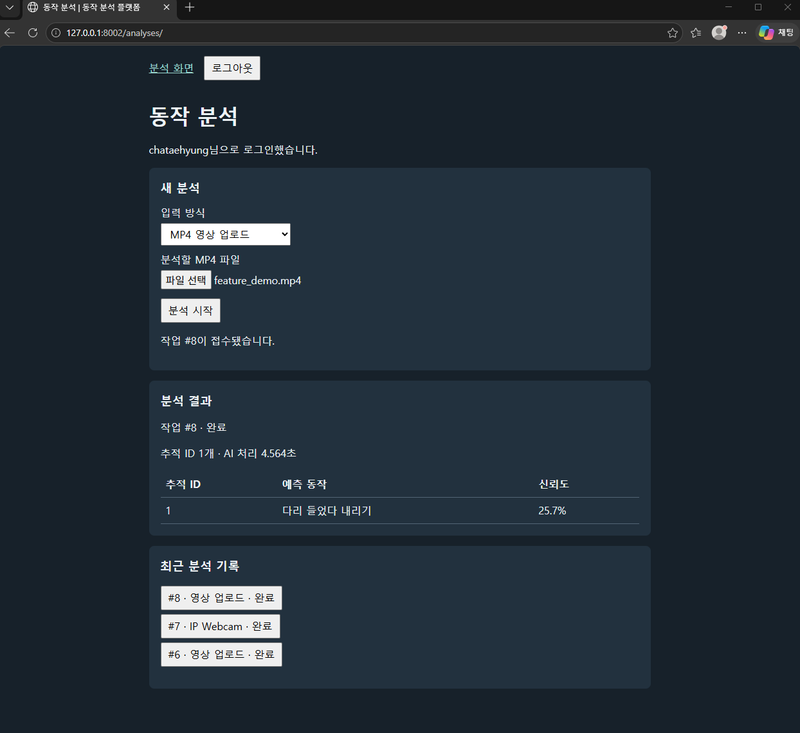
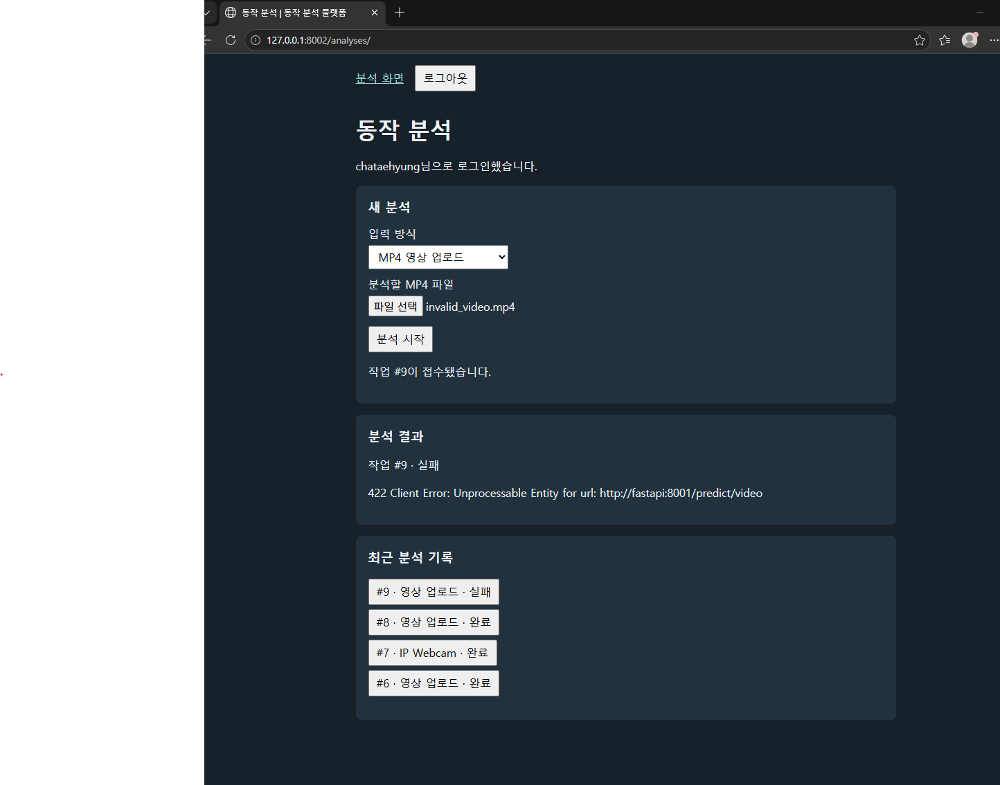
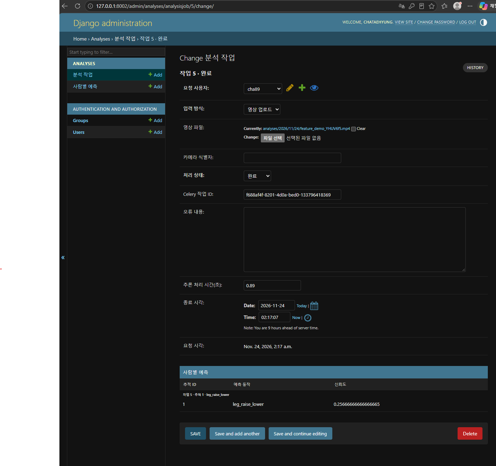
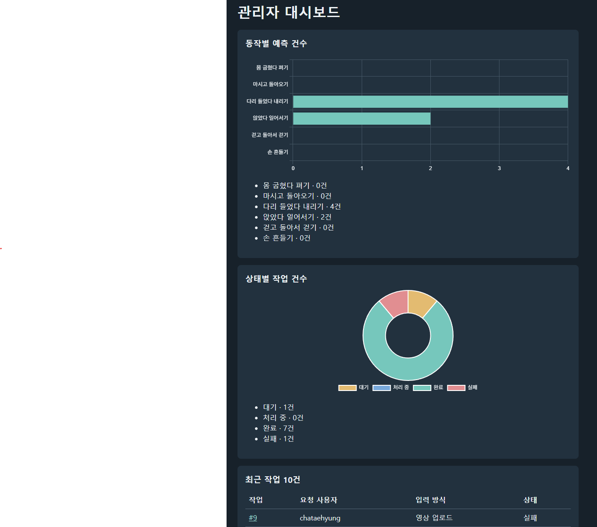

# 교과10 동작 분석 플랫폼

MP4를 올리거나 등록된 휴대폰 카메라로 8초간 촬영하면 영상 속 사람별로 동작을 예측합니다. 사용자는 작업 번호로 진행 상태와 결과를 확인하고 기록에 메모를 남길 수 있습니다. 관리자는 전체 작업과 동작별 예측 건수를 조회합니다.

## 1. 실행 방법

Windows + WSL2 Ubuntu, Docker Desktop의 Ubuntu 통합, Docker Compose를 사용합니다. 아래 명령은 `compose.yaml`이 있는 프로젝트 최상위에서 실행합니다.

### 모델과 환경변수 준비

기존 교과10 실습에서 같은 학습 실행의 산출물 3개와 해당 Pose 가중치를 준비합니다. 다음은 이 프로젝트에서 사용한 WSL 원본 경로입니다. 다른 PC에서는 `SOURCE_DIR`을 실제 경로로 바꿉니다.

```bash
cd ~/ai_vision/vision_action_platform
SOURCE_DIR="$HOME/ai_vision/subject10_pose_action/subject10_pose_action"
mkdir -p ai_service/models
cp -i "$SOURCE_DIR"/artifacts/day06/{rf_action_baseline.joblib,rf_feature_columns.json,rf_training_info.json} ai_service/models/
cp -i "$SOURCE_DIR/yolo11n-pose.pt" ai_service/models/
```

`ai_service/src/`에는 교과10의 `pose_utils.py`, `feature_utils.py`, `sequence_utils.py`, `realtime_utils.py`가 들어갑니다. 설정 원본은 `configs/project.json`이며 새 위치는 `ai_service/project.json`입니다. 사람별 추적과 시퀀스 수집은 `services/pose_pipeline.py`에서 처리합니다.

최초 설치 시 환경변수 예시를 복사하고 편집합니다. 기존 설치에서는 사용 중인 DB 비밀번호를 유지합니다.

```bash
cp -n .env.example .env
code .env
```

| 환경변수 | 설정 |
|---|---|
| POSTGRES_DB / POSTGRES_USER | 기본 예시는 vision_action / vision_user |
| POSTGRES_PASSWORD | 첫 실행 전에 로컬 전용 비밀번호 지정 |
| POSTGRES_HOST / POSTGRES_PORT | WSL에서 DB 접속 시 127.0.0.1 / 55432. Compose 내부에서는 postgres / 5432로 설정 |
| IP_WEBCAM_URL | 휴대폰 앱의 실제 영상 스트림 URL. 비워 두면 MP4 업로드만 사용 가능 |

카메라를 사용할 때에는 PC와 휴대폰을 같은 네트워크에 두고 앱 서버를 켭니다. 사용자는 등록된 ID `phone`을 선택합니다. 실제 URL과 비밀번호는 Git에서 제외한 `.env`에 보관합니다.

### 최초 실행

```bash
docker compose up -d --build --wait
docker compose exec django python manage.py migrate
docker compose exec django python manage.py createsuperuser
docker compose ps
```

관리자 계정은 최초 한 번 생성합니다. 일반 사용자는 회원가입 화면을 이용합니다. WSL에서 별도로 실행했던 Django·Uvicorn·Celery가 있다면 Docker 전환 전에 해당 프로세스를 종료합니다.

| 화면 | 로컬 주소 |
|---|---|
| 회원가입 | http://127.0.0.1:8002/accounts/signup/ |
| 로그인 및 사용자 분석 | http://127.0.0.1:8002/analyses/ |
| Django 관리자 | http://127.0.0.1:8002/admin/ |
| 관리자 통계 | http://127.0.0.1:8002/dashboard/ |
| FastAPI 문서 / 상태 | http://127.0.0.1:8001/docs · http://127.0.0.1:8001/health |

다시 시작할 때는 `docker compose up -d --wait`, 일시 정지할 때는 `docker compose stop`을 사용합니다.

## 2. 전체 아키텍처



Django와 Worker는 업로드 영상 폴더를 공유합니다. PostgreSQL 데이터는 Compose 볼륨에, 업로드 파일은 호스트의 `backend/media/`에 저장합니다. 카메라 촬영본은 Worker의 임시 폴더에서 추론 후 정리합니다.

## 3. 데이터베이스 설계



회원은 Django 기본 User를 사용합니다. `backend/analyses/models.py`의 AnalysisJob 한 행은 요청 한 건을, PersonPrediction 한 행은 그 영상의 추적 ID 한 개에 대한 결과를 저장합니다. 같은 작업에서 추적 ID는 고유합니다. 사람 두 명을 예측하면 작업 1건에 결과 2건이 연결됩니다.

## 4. 분석 시작 버튼의 처리 순서



| 사용자 API | 동작 |
|---|---|
| POST /api/v1/analyses/ | MP4 또는 등록된 카메라 작업 접수 |
| GET /api/v1/analyses/ | 로그인 사용자의 기록 조회 |
| GET /api/v1/analyses/{id}/ | 상태, 메모, 처리 시간, 사람별 결과 조회 |
| PATCH /api/v1/analyses/{id}/ | 본인 작업의 memo만 변경 |
| DELETE /api/v1/analyses/{id}/ | 본인 기록 삭제. 처리 중이면 409, 타인 기록은 404 |

## 5. 모델과 입력 형식

YOLO Pose 가중치 `yolo11n-pose.pt`로 사람별 17개 관절 좌표를 추출하고 ByteTrack으로 추적 ID를 연결합니다. 한 시점의 38개 특징은 정규화한 관절 좌표 34개와 팔꿈치·무릎 각도 4개입니다. 같은 ID에 유효 프레임이 10개 이상이면 프레임 번호에 따라 30개 시점으로 보간하고 1,140개 값으로 펼칩니다.

- `rf_action_baseline.joblib` — 6개 동작을 예측하는 Random Forest
- `rf_feature_columns.json` — 입력 특징 1,140개의 이름과 순서
- `rf_training_info.json` — 시퀀스 길이·클래스·학습 설정

동작 클래스는 bend_return, drink_return, leg_raise_lower, sit_stand, walk_turn_walk, wave입니다. Worker는 `POST /predict/video`에 multipart 필드 `file`로 MP4를 전송합니다. 응답에는 predictions 목록의 track_id, action_label, confidence와 processing_seconds가 들어갑니다. 유효 프레임이 부족하면 예측 목록은 비어 있을 수 있습니다.

이번 모델은 학습 정보 기준 S01 한 사람의 클립 6개로 학습했습니다. 아래 신뢰도는 개별 추론의 모델 점수이며 새 사람에 대한 분류 정확도는 별도 평가가 필요합니다.

## 6. 실행 결과와 오류 처리

| Docker 실측 | 결과 | 모델 신뢰도 | AI 처리 시간 |
|---|---|---:|---:|
| 작업 #6 · feature_demo.mp4 | ID 1 · 다리 들었다 내리기 | 25.7% | 3.825초 |
| 작업 #7 · IP Webcam 8초 | ID 1 · 앉았다 일어서기 | 28.0% | 3.022초 |
| 작업 #8 · feature_demo.mp4 | ID 1 · 다리 들었다 내리기 | 25.7% | 4.564초 |

AI 처리 시간은 FastAPI 요청 처리 구간입니다. 카메라의 8초 촬영은 별도입니다. 5개 서비스를 정지 후 재시작하여 작업 #6과 #7 모두 SUCCESS이고 예측이 각각 1건임을 확인했습니다. 작업 #6의 업로드 파일도 유지됐습니다.

**실제 기동 오류.** Docker 전환 중 8001 포트 공개에 실패해 FastAPI 시작이 막혔고, 의존 서비스인 Celery도 실행되지 않았습니다. 기존 WSL 서버의 포트 점유를 점검한 뒤 Compose를 다시 기동해 Worker의 pong과 작업 #6 완료를 확인했습니다.

**잘못된 영상 업로드.** 작업 #9에서 `invalid_video.mp4`를 업로드하자 FastAPI가 HTTP 422를 반환했고, 분석 결과와 최근 기록에 실패가 표시됐습니다.

**관리자 화면.** /admin/에서는 작업 상태와 사람별 결과를 확인합니다. /dashboard/에서는 전체 사람별 예측을 동작별로, 전체 요청을 상태별로 집계합니다. 작업 #9 처리 후 대시보드에 대기 1건, 처리 중 0건, 완료 7건, 실패 1건이 표시됐습니다. 사람별 예측은 다리 들었다 내리기 4건, 앉았다 일어서기 2건으로 총 6건이었습니다.

### 실행 화면

#### MP4 업로드 분석 성공



작업 #8에서 feature_demo.mp4를 분석한 결과, 추적 ID 1의 동작은 ‘다리 들었다 내리기’로 예측됐습니다. 신뢰도는 25.7%, AI 처리 시간은 4.564초였습니다.

#### 잘못된 MP4 업로드



작업 #9에서 invalid_video.mp4를 업로드하자 FastAPI가 HTTP 422를 반환했고, 사용자 화면에 실패 상태와 오류 메시지가 표시됐습니다.

#### Django 관리자 작업 상세



관리자는 작업 #5의 상세 화면에서 업로드 파일, 완료 상태, 처리 시간과 추적 ID 1의 예측 결과를 함께 확인할 수 있습니다.

#### 관리자 대시보드



전체 작업 9건은 대기 1건, 완료 7건, 실패 1건이었습니다. 사람별 예측은 ‘다리 들었다 내리기’ 4건과 ‘앉았다 일어서기’ 2건이었습니다.

## 7. 테스트 및 점검

프로젝트 최상위에서 실행합니다. 테스트 코드 변경 후에는 백엔드 이미지를 먼저 갱신합니다.

```bash
docker compose build django
docker compose up -d --wait django celery
docker compose exec -T django python manage.py check
docker compose exec -T django python manage.py test accounts analyses -v 2
docker compose exec -T celery celery -A config inspect ping --timeout=5
```

회원 및 분석 테스트 12개가 0.423초에 모두 통과했습니다(`OK`). 실행 로그는 `docs/test-results.txt`에 기록했습니다. 테스트는 별도 PostgreSQL DB를 사용합니다. 확인 범위에는 회원가입·로그인, 사용자별 조회, 성공·실패 저장, 중복 처리 방지, 메모 수정 권한, 삭제 시 파일 정리와 처리 중 작업 보호가 포함됩니다.

화면에서 작업 상태가 바뀌지 않으면 다음 순서로 확인합니다.

```bash
docker compose ps -a
docker compose logs --tail=50 celery fastapi
curl -fsS http://127.0.0.1:8001/health
```

## 주요 파일 위치

| 위치 | 역할 |
|---|---|
| backend/accounts/ | 회원가입·로그인·로그아웃 |
| backend/analyses/ | 모델, DRF API, 카메라 촬영, Worker, 관리자 통계 및 테스트 |
| backend/config/ | Django 설정, 전체 URL, Celery 앱 |
| backend/templates/ · backend/static/ | 입력 폼, 상태 자동 조회, 이력, Chart.js 대시보드 |
| ai_service/routers/ · ai_service/services/ | 영상 검증, 모델 로딩, 사람별 시퀀스 생성과 예측 |
| ai_service/src/ · ai_service/models/ | 교과10 전처리 코드와 학습 산출물 |
| compose.yaml · .env.example | 서비스 구성과 로컬 설정 예시 |
